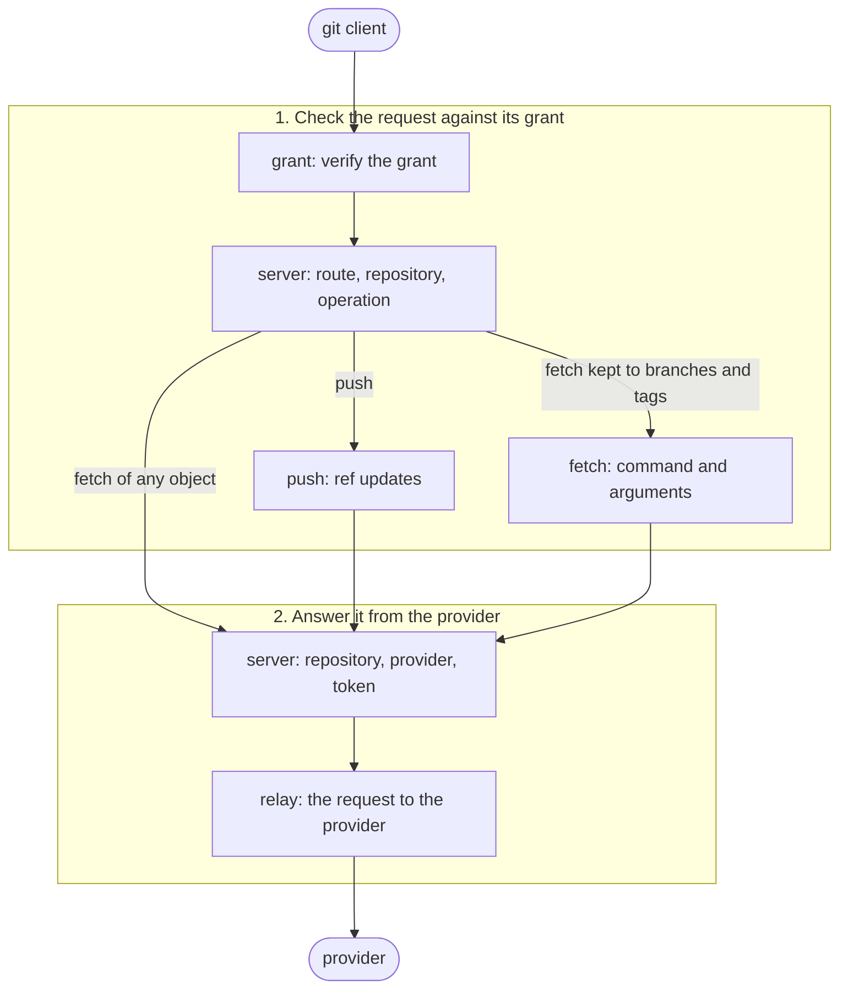

# Git relay

`scm.git` runs `git fetch` and `git push` for a service that holds no provider credentials. The client sends each
request with a signed grant, and `GitServer` relays the requests the grant allows to the provider with Sentry's token.

`GitServer` answers a request in two steps. The first reads only the request and its grant, so a request the grant
doesn't allow never reaches the database, the token supplier or the provider.

| Module | Job |
| --- | --- |
| `types` | The grant and its fetch and push rules. |
| `grant` | Signs and verifies grants. |
| `server` | `GitServer`: the order of the steps, refusals and metrics. |
| `push` | Keeps a push to its rules. |
| `fetch` | Keeps a fetch to the branches and tags its rules name: `check_fetch` in step 1, `respond` in step 2. |
| `relay` | Sends a request to the provider with the token, streaming both ways. |
| `pktline` | The pkt-line framing that fetch and push share. |

Each module's docstring holds the detail. `bin/git-server --check` runs real git through all of it against a real
provider.
